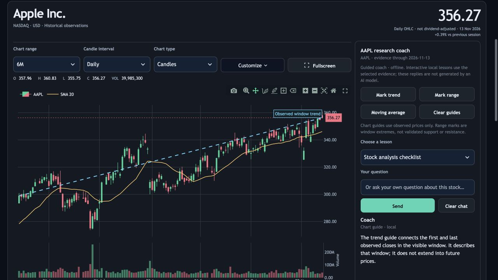
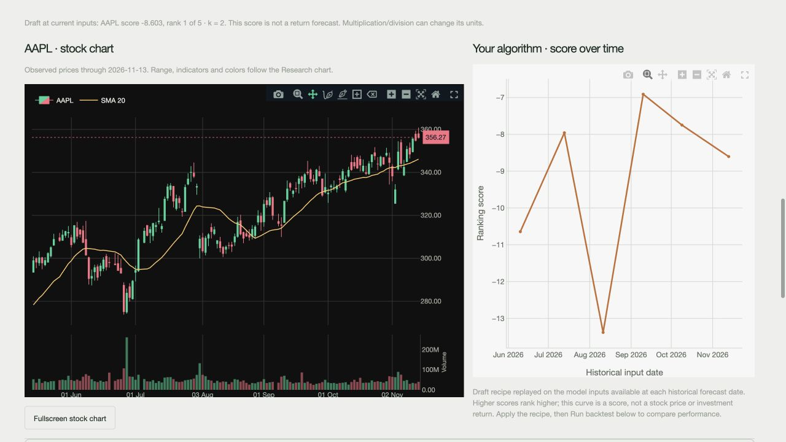

# DerivPort

**Interactive equity research, algorithm building, and calculus sensitivity analysis.**

DerivPort is an educational finance project for the Veritas AI Hackathon. Explore a stock, turn an idea into a transparent ranking rule, and test it against historical evidence—all in one workspace.

[Quick start](#quick-start) · [Two-minute tour](#two-minute-tour) · [How it works](#how-it-works) · [Documentation](#documentation)



*Research: observed prices, customizable charts, and a coach grounded in the selected historical view.*



*Algorithm builder: compare the stock chart with your recipe’s score curve. A ranking score is different from an investment return.*

## What you can explore

| Workspace | What it does |
| --- | --- |
| **Research** | Browse US-listed equities, inspect candlesticks, read dated company evidence, and compare model and algorithm rankings. |
| **Algorithm builder** | Start with a guided recipe or arrange factor blocks. Preview score contributions, explore calculus, and run a historical backtest. |
| **Future scenarios** | Explore assumption-driven paths through 2037, with adjustable growth, volatility, and correlation. |
| **Benchmarks** | Compare six forecasting methods, alternative ranking rules, and hypothetical portfolios using chronological evaluation. |

Switch between **Day** (pastel gray), **Night** (dark), and **Pause** (bright green) at the top of the page. Stock charts, fullscreen charts, and algorithm views follow the selected mode. Settings and deeper research tools stay collapsed until needed.

## Quick start

Tested with **Python 3.13**. On macOS or Linux:

```sh
git clone https://github.com/bvnnydevv/DerivPort.git
cd DerivPort
python3 -m venv .venv
.venv/bin/python -m pip install -r requirements.txt
.venv/bin/streamlit run app.py
```

Open [localhost:8501](http://localhost:8501). On Windows, use the executables in `.venv\Scripts` instead of `.venv/bin`.

**No API key is needed for the bundled demo.** After installation, bundled price history, charting, guided lessons, algorithm experiments, and simulations work offline. News, provider searches, uncached stocks, refreshes, and external links require internet access.

To publish a shareable demo, follow the [Streamlit Community Cloud hosting guide](docs/HOSTING.md). Use repository `bvnnydevv/DerivPort`, branch `main`, and entry point `app.py`.

## Two-minute tour

1. **Explore a stock.** Start with AAPL in Research. Use **Customize** for moving averages, candle intervals, colors, and volume; open **Fullscreen** to inspect the chart. Type a question into the coach or use **Chart tools** to mark a trend or range.
2. **Build an idea.** In Algorithm builder, adjust the model/recent-strength mix and risk penalty. The orange score graph updates with the draft; the stock-price data stays fixed. Inspect the contribution table, then choose **Apply blocks to algorithm**.
3. **Test and explain it.** Run a historical backtest to compare your rule, the model, momentum, and the selected stock’s buy-and-hold return. Open **Explore the formula & Calculus Lab** to see how a small input change affects slope, curvature, and accumulated score change.
4. **Explore a possible future.** In Future scenarios, change Low/Medium/High risk and simulate through a target date. The purple price bands and amber return distribution show what the assumptions produce—not known future prices.

For a repeatable historical example, open **Settings**, select **Frozen demo (2018–2024)** and the original five-stock group, then choose **AAPL · May 3, 2024**. In Research tools, reveal the next 21 sessions only after inspecting the evidence. This example was curated for an understandable earnings discussion, not as proof of a successful forecast.

## How it works

### Price charts and company news

Research and the builder share the same selected stock, chart range, candle colors, and indicators. Charts support daily/weekly/monthly candles, SMA/EMA overlays, volume, log scale, pan, zoom, drawing tools, and exports.

**Company news** searches a rolling seven-day window on demand. Each headline includes its publisher, publication date, and source link. Ten appear initially; **More headlines** expands the list, up to fifty. The app shows the actual supplied date range because the provider may return less than a full week. A conservative title filter can miss aliases or articles that omit the company name and ticker.

**Price move around an event** measures observed 1-, 5-, and 21-session changes around a dated announcement or article. It uses the first observed session after the publication date and its preceding close as the baseline; publication-day moves are excluded. Precise timestamps use the New York calendar date. Missing outcomes remain pending. These changes describe an association, not proof that the news caused the move.

### Transparent algorithms and calculus

The initial active rule is:

$$
S=\widehat r_{21}-k\varepsilon,\qquad k=2.
$$

Here, $\widehat r_{21}$ is the local regression’s estimated return over the next 21 trading sessions, and $\varepsilon$ is its typical past forecast error. Higher scores rank higher within the comparison group.

Guided recipes combine model outlook, recent strength, past forecast error, and price swings. Advanced blocks and the text editor use the same restricted arithmetic parser. Draft changes affect the preview; **Apply** activates the block recipe. The orange curve replays the draft on historical forecast inputs, rather than inventing daily predictions or treating scores as returns.

The named **DerivPort Signal** preset combines 60% model estimate and 40% momentum with error and volatility penalties. Its standalone [Python download](algorithms/derivport_signal.py) defaults to `k = 1`; guided drafts retain the current multiplier. See the [algorithm guide](algorithms/README.md) for exact inputs and usage.

Calculus Lab renders the formula in LaTeX and explores derivatives, curvature, tangent and quadratic approximations, and the integral of the derivative. These explain the ranking rule’s arithmetic, not the regression’s feature influence.

### Historical evidence and future scenarios

The default prediction model is standardized **Ridge regression** using past momentum and volatility. Training uses completed historical labels; the error estimate uses completed out-of-sample forecasts. The Benchmarks workspace adds Elastic Net, Random Forest, Gradient Boosting, momentum, and zero-return baselines.

Future scenarios use **600 correlated lognormal paths by default**, anchored to the latest observed adjusted close. Volatility comes from up to three years of past daily returns. Annual log-price drift and correlation are user assumptions; Low/Medium/High applies 0.75×/1×/1.5× historical volatility. The bands are simulated percentiles, not calibrated confidence intervals. News, the DIY ranking rule, and the 21-session regression do not generate these long-range paths.

### Optional AI coach

The local regression and the conversational coach are separate. Without a key, the coach provides clearly labeled prepared lessons and local chart guides. For AI-generated explanations, add `OPENAI_API_KEY` to the hosting service’s secrets or the ignored `.streamlit/secrets.toml`; `OPENAI_MODEL` is optional.

An explicit question submission sends the question, a bounded conversation, and selected public historical evidence to OpenAI. Current news and future outcomes stay outside that historical context. Never commit credentials. The bundled demo remains usable without this integration.

## Data and research boundaries

| Included snapshot | Coverage |
| --- | --- |
| **US equity directory** | 6,094 current listing candidates after disclosed filters, from NasdaqTrader files dated **November 13, 2026**. |
| **Offline US price history** | 15 adjusted-price histories through **November 13, 2026**. Additional listings load their available history on selection. |
| **Offline candlesticks** | 33,450 daily OHLCV bars across 15 US stocks, from **2018-01-02 to 2026-11-13**. |

The directory includes qualifying common shares, ADRs, preferred shares, and partnership equity units across exchanges. It is not an archive of every historical, delisted, or OTC security; provider coverage varies.

Candles use unadjusted OHLCV. Model inputs and return comparisons use adjusted closes, so displayed price levels can differ. Prices are cached daily observations, not a live intraday feed. No missing historical prices or candles are fabricated.

Historical cutoffs restrict displayed evidence; subsequent returns stay hidden until explicitly revealed. Current news is kept separate from historical model and coach inputs. Adjusted vendor snapshots can still change with later corporate actions, and chosen stock groups have selection and survivorship bias.

Backtests are retrospective experiments. The builder’s linked returns omit execution costs and taxes; the separate Benchmarks portfolio engine models delayed fills, commission, slippage, sizing, and drawdowns. Repeated tuning can overfit. This is an educational research app with hypothetical allocations, not brokerage access or investment advice.

## Documentation

| Resource | Contents |
| --- | --- |
| [Hosting](docs/HOSTING.md) | Deployment and presentation checks. |
| [Research methods](docs/RESEARCH_METHODS.md) | Chronological evaluation, models, signals, portfolios, and inference. |
| [Measured results](docs/RESEARCH_RESULTS.md) | Retained experiments, comparisons, and limitations. |
| [Chart data](docs/CHART_DATA.md) · [Data credits](data/CREDITS.md) | Price provenance, caching, and source terms. |
| [Algorithm guide](algorithms/README.md) | Standalone Python algorithm and input format. |
| [Figma logo](https://www.figma.com/design/ZxLybASxv0lxyUkdnQ33A2/Hackathon-DerivPort?node-id=8-8) · [Brand](docs/BRAND.md) | Editable logo source and SVG provenance. |

## Verify and reproduce

```sh
.venv/bin/python -m pip install -r requirements-dev.txt
.venv/bin/python -m pytest -q
```

Tests cover cutoff boundaries, formula safety, draft/active isolation, matched chart data, pending outcomes, news dates, calculus, and reproducible simulations. Core dashboard tests block outbound network calls.

To reproduce the fixed-cache research experiment:

```sh
.venv/bin/python scripts/run_research.py --dataset frozen --validation-start 2020-01-01 --test-start 2023-01-01 --end 2024-12-31 --output artifacts/research_runs/frozen-demo
```

The export includes input prices, forecasts, scores, folds, trades, NAV, diagnostics, and a manifest recording hashes and settings.

Application code is [MIT licensed](LICENSE). Market data and issuer material retain their source terms; see [data credits](data/CREDITS.md) and [image credits](assets/CREDITS.md).
