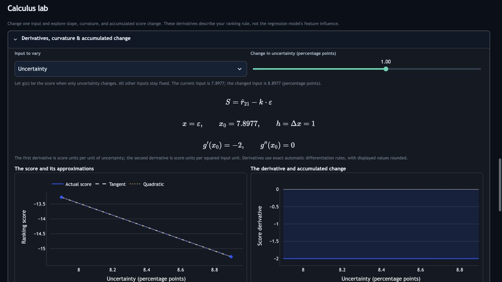

# DerivPort




An educational stock-research and algorithm lab for the Veritas AI finance challenge. Compare dated company evidence with a **quant analyst — model and ranking**, edit a mathematical rule, and reveal what happened next. **Research**, **Algorithm builder**, **Future scenarios**, and **Research & Benchmarking** provide historical evidence, rule experiments, hypothetical projections, and reproducible model/portfolio comparisons. No brokerage connections, account balances, live orders, or buy/sell recommendations; portfolio holdings are hypothetical research allocations.

[Figma design](https://www.figma.com/design/ZxLybASxv0lxyUkdnQ33A2/Hackathon-DerivPort?node-id=1-7) · [Interface direction](docs/DESIGN.md)

The [DerivPort logo component](https://www.figma.com/design/ZxLybASxv0lxyUkdnQ33A2/Hackathon-DerivPort?node-id=8-8) was created and exported in Figma. Its editable source and exact SVG provenance are documented in [Brand](docs/BRAND.md).

## Run locally

Tested with Python **3.13**:

```sh
python3 -m venv .venv
.venv/bin/python -m pip install -r requirements.txt
.venv/bin/streamlit run app.py --server.address 127.0.0.1
```

Open **http://127.0.0.1:8501**. Installation requires internet. Once installed, all bundled and previously downloaded stock histories work offline. Explicit provider search, adding an uncached stock, refreshing history, and opening external source links require internet. No API key is required. Dependencies include Streamlit, pandas, NumPy, scikit-learn, Plotly, and `yfinance==1.8.0`.

## Host a demo

Deploy this repository on [Streamlit Community Cloud](https://share.streamlit.io/) with repository **`bvnnydevv/DerivPort`**, branch **`main`**, entrypoint **`app.py`**, and Python **3.13** in Advanced settings. The bundled demo needs no secrets or API keys. See the [hosting guide](docs/HOSTING.md) for the complete steps and demo checks.

## Explore stocks and dates

**Full cached history** is the default data range, making the supplied 2026 observations available directly. For the reproducible presentation, choose **Frozen demo (2018–2024)**, the original AAPL/MSFT/NVDA/AMZN/GOOGL group, and **Apple on May 3, 2024**. That example follows Apple's May 2 earnings release and was curated for clear, mixed business evidence, not to demonstrate a successful forecast.

The explorer shows **6,094 current US equity candidates** from the official NasdaqTrader Nasdaq and other-exchange directories, source files dated **2026-11-13**. Use **Exchange** and the searchable **Stock** selector to browse the full snapshot, rather than only the bundled stocks. Exchanges include NASDAQ, NYSE, NYSE American, NYSE Arca, Cboe and TXSE where qualifying listings are present. US-listed ADRs, preferred shares and partnership equity units are included; explicit filters remove ETFs, test issues, debt and derivatives. New downloads verify the provider's equity identity. Name-based classification and provider history coverage have limits: this is a current listing snapshot, not every historical, delisted or OTC security.

**15 US adjusted-price histories** are supplied offline through November 13, 2026; the full listing directory also works offline. Selecting an uncached stock downloads only that stock's available history, rather than thousands of series at startup. Select **2–10 stocks** for research. A temporarily browsed stock joins the group while selected; explicit group edits remain available. Recently listed stocks can show an observed chart even when they lack enough shared history for the model. Unavailable additions do not block returning to a cached stock. Earlier international cache files and low-level APIs remain archived for reproducibility but are not exposed in the explorer. New runtime downloads are ignored by Git.

Refresh the verified listing snapshot explicitly with `.venv/bin/python scripts/refresh_us_directory.py`. Its source URLs, filters, counts, timestamps and checksums are recorded in `data/us_listings_provenance.json`; failed publication restores the previous snapshot.

Choose a daily historical cutoff through the latest observed date in the selected group. Weekends and missing dates normalize to the preceding shared session. Cutoffs begin after at least 252 shared observations and no earlier than April 1, 2020. Research can use the latest close even when its next 21 sessions have not happened; outcome reveal remains disabled until all 21 subsequent observations are cached. The old 2024 limit came from the default frozen cache, and the earlier replay-date cap reserved those 21 future observations.

The supplied cache covers **part of 2026, through November 13**, not the rest of that year. Comparisons use **shared observed sessions**, without forward filling.

## Customizable stock charts

The main stock chart defaults to **real candlesticks**, with genuine daily open, high, low, close and volume. Change **Chart range** (1M through All), **Candle interval** (daily/weekly/monthly), or **Chart type** (candles/OHLC/line). **Customize** controls SMA 20/50 and EMA 20 indicators, volume, grid lines, logarithmic price scale, and up/down colors. **Fullscreen** opens a viewport-sized chart workspace; close it to return. Pan, zoom, crosshair, draw-line/freehand/rectangle, erase, reset and image-export tools remain available. Drawings are temporary browser annotations; chart preferences persist during the session.

The bundled candle snapshot contains **33,450 daily bars across 15 US stocks**, from 2018-01-02 through 2026-11-13, so the standard charts work offline. **All** means all cached candles. An explicit download/refresh can request the provider's available full daily history. Chart-data export includes only the displayed observations and indicators. Weekly/monthly bars truncate observations at the historical cutoff before aggregation, and their last bar can be partial; indicator periods count bars of the selected interval.

Candles use a separate vendor OHLCV cache with no dividend adjustment; research retains the original dividend-adjusted close inputs. A historical candle close can therefore differ from the research close. Close-only history displays an explicitly labeled line until real candles are downloaded; OHLC bars and volume are never invented. These are cached daily observations, with no intraday or live quote feed. See [chart data and provenance](docs/CHART_DATA.md).

## Appearance, blocks and the stock coach

The default is a **light pastel-gray editorial workspace** with **Helvetica Neue** throughout the interface and charts. The reference-led design uses muted sage accents, fine rules, flat sections and Helvetica-style typography with generous spacing. The existing stock chart retains its dark appearance and controls. Settings, model details and rankings stay collapsed to keep the main chart and chat clear. **Theme** offers Editorial, Midnight, Graphite, Deep ocean, a custom background, an accent color, compact/comfortable spacing, and an illustration toggle. Original illustrations are bundled locally; [image credits and licenses](assets/CREDITS.md) are retained. Website text contains no emojis.

In **Algorithm builder**, begin with Guided mode: choose a starting idea, adjust the model/recent-strength mix and risk penalty, inspect a plain-English recipe and its score contributions, then explicitly Apply and test on past data. Advanced blocks retain the interlocking factor blocks; drag them to reorder them, change operators and weights, add/remove factors, or use the keyboard editor. Changes remain a draft until **Apply blocks to algorithm**. The compiled expression goes through the existing safe formula parser and drives the same scores, calculus and historical backtest as the text editor. Export the block stack as JSON or its standalone Python algorithm. Balanced, momentum and defensive starting stacks are examples rather than optimized trading rules.

The **research coach is embedded inside the selected stock panel**. Type in the inline chat composer and press Enter or its arrow-send button. The conversation appears above the composer; suggested questions and chart actions stay available. Its chart controls can mark an observed endpoint trend, identify the displayed window's low/high levels, show a moving average, or clear coach guides. Natural-language drawing requests map to these bounded actions; no model-generated code or arbitrary coordinates are executed. Guides use only observations through the selected cutoff, reset with the research context, and do not claim validated support/resistance or future price targets.

Without an API key, the coach provides explicitly labeled **offline guided lessons** grounded in the selected evidence. To enable actual AI-generated explanations, configure `OPENAI_API_KEY` in the hosting service's secrets or the ignored `.streamlit/secrets.toml`; optionally set `OPENAI_MODEL` (default `gpt-5.4-mini`). Never commit a real key. Example secret names:

```toml
OPENAI_API_KEY = "your-server-side-key"
OPENAI_MODEL = "gpt-5.4-mini"
```

Only pressing **Send** makes an AI request, sharing that question, the selected public historical snapshot and a bounded conversation. Future outcomes and private account/holding fields are excluded; the app never requests brokerage details. An AI-service failure falls back to a clearly labeled local lesson. The integration uses OpenAI's [Responses API](https://developers.openai.com/api/reference/resources/responses/methods/create) and the documented [model](https://developers.openai.com/api/docs/models/gpt-5.4-mini). Live API access requires a configured account/key; automated verification uses stubs rather than a paid request.

**Future scenarios** adds Low/Medium/High volatility presets (0.75×/1×/1.5× historical volatility), plus Custom. Presets preserve the user's log-drift and correlation settings. A purple percentile fan and a separate amber terminal-return histogram distinguish hypothetical scenarios from observed stock charts. The same log drift preserves the analytical median-growth assumption, while volatility changes the distribution and can also change its arithmetic mean; higher risk is not a promise of higher returns.

## Company news and event windows

Use **Company news → Update news** to fetch a headline digest from the past seven days for the selected stock; add a topic such as earnings or a lawsuit to narrow the search. Headlines include publisher, publication date, source link and retrieval time. A conservative title filter requires the company name or ticker; aliases and relevant articles that omit both can be missed. Nothing loads until requested; news uses the existing yfinance provider and needs internet, with no extra API key. Actual supplied dates are shown; provider feeds may cover less than all seven days. This current feed is not a complete historical news archive and never enters historical model or coach inputs.

Open **Price move around an event** to choose a dated headline or enter an announcement date. The chart and 1-, 5- and 21-session changes use observed adjusted closes through the selected research cutoff. Unknown publication timing uses the first observed session strictly after the publication date, with its preceding close as baseline; publication-day moves are excluded. Missing horizons remain pending. These are descriptive price changes, not proof that an announcement or negative coverage caused the move.

## Reproducible research and benchmarking

The **Research & Benchmarking** tab adds six aligned return-forecast methods: unchanged Ridge, Elastic Net, Random Forest, Gradient Boosting, momentum, and zero return. The original balanced signal remains selectable alongside standardized, risk-adjusted, uncertainty-penalized, and development-fitted constrained alternatives. Model selection, preprocessing and signal fitting use chronological completed labels; final-test hyperparameters and weights stay frozen.

Prediction accuracy, cross-sectional ranking IC, and hypothetical portfolio performance are reported separately. Portfolio experiments use delayed fills, diversified capped targets, residual cash, daily drawdowns, commission and slippage, and explicit liquidation. Unknown currencies disable portfolio results. Statistical comparisons use paired date-block resampling and Holm adjustment; small samples remain explicitly inconclusive.

Run the documented fixed-cache experiment offline:

```sh
.venv/bin/python scripts/run_research.py --dataset frozen --validation-start 2020-01-01 --test-start 2023-01-01 --end 2024-12-31 --output artifacts/research_runs/frozen-demo
```

The export includes input prices, sources, forecasts, scores, folds, trades, daily NAV, confidence diagnostics and a manifest with hashes, settings, software versions and the reproduction command. Additional cached universes use `--dataset cache --symbols AAPL,MSFT,JPM`; uncached symbols are rejected without a provider request.

Read the [prioritized audit](docs/AUDIT.md), [mathematical methods](docs/RESEARCH_METHODS.md), [measured experiment](docs/RESEARCH_RESULTS.md), and [upgrade/file summary](docs/UPGRADE_SUMMARY.md). No alternative automatically replaces Ridge or the original balanced rule, and no positive performance improvement is assumed.

## Research and algorithm experiments

Both analyst panels use the same stock and cutoff. Company notes separate reported facts, editorial interpretation, and open questions, with the publication date and official source link. Date-only notes must be published strictly before the cutoff date; publication-day embargoes prevent after-close information from entering that day's view. The 20 verified notes are a limited collection; additional symbols and dates may lack suitable company evidence. No narrative or disagreement is invented, and qualitative notes receive no predictive-accuracy score.

Three algorithms rank the same comparison group:

- **Momentum:** trailing 21-session adjusted-price return.
- **AI model:** regression estimate of the next 21-session return.
- **Student algorithm:** an editable expression, initially `predicted_return - k * uncertainty`, with `k = 2`.

The quant dashboard includes your named balanced rule, **DerivPort Signal**. In **Algorithm builder**, click **Use my balanced algorithm** to load:

```text
0.6 * predicted_return + 0.4 * momentum - k * (0.5 * uncertainty + 0.25 * volatility)
```

The starting `k = 1` balances a 60/40 model–momentum blend against explicit error and volatility penalties. These are transparent starting weights, not optimized parameters or evidence of profitability. Download the standalone [Python algorithm](algorithms/derivport_signal.py) and the cutoff's input CSV from the app. It uses only Python's standard library:

```sh
python3 derivport_signal.py --input features.csv --output ranked.csv --k 1
```

The file reproduces the app's scores and average tied ranks. [Algorithm documentation](algorithms/README.md) explains the inputs, coefficients, and measured frozen-cache research results.

You can also edit `predicted_return`, `uncertainty`, `momentum`, `volatility`, `k`, numeric constants, arithmetic, and parentheses. A restricted AST parser rejects calls, attributes, powers, division by zero, and non-finite results. Invalid edits preserve the last valid formula, k, scores, and ranks.

Formulas, substituted arithmetic, error definitions, and calculus are rendered in LaTeX. The score-versus-uncertainty chart holds other inputs fixed and marks the current score. For the default rule:

$$
S=\widehat r_{21}-k\varepsilon,\qquad
\frac{\partial S}{\partial\varepsilon}=-k,\qquad
\frac{\partial^2 S}{\partial\varepsilon^2}=0.
$$

At k = 2, one extra percentage point of uncertainty lowers the score by two percentage points. Crossover examples distinguish a changing score from a changing relative rank.

The interactive calculus lab varies one input while keeping the others fixed. It compares the actual score change with first-order tangent and second-order Taylor approximations, plots the score and derivative, displays curvature, and checks the fundamental theorem of calculus by numerically integrating the derivative along the selected interval. Gradient and Hessian values come from exact automatic differentiation of the restricted arithmetic expression; numerical quadrature remains an approximation. Singular or undefined intervals are reported without replacing the last valid ranking.

$$
\Delta S\approx S'(x_0)\,\Delta x+
\tfrac12 S''(x_0)(\Delta x)^2,\qquad
S(b)-S(a)=\int_a^b S'(x)\,dx.
$$

These derivatives explain the **editable ranking arithmetic**, not the regression model's feature influence or a stock's future return. All return-like inputs remain in percentage points; k is dimensionless. The lab identifies units and holds other inputs fixed.

**Research** hides subsequent returns, realized ranks, and single-date ranking accuracy until **Reveal next 21 trading days**. Recent cutoffs show a pending-outcome message instead of invented results. Reveal freezes that experiment's predictions; later rule edits are labeled **edited after seeing the outcome**. Another unrevealed cutoff provides a fresh experiment. Reveal context includes the universe, cutoff, and price-data fingerprint, so changing the experiment does not expose another experiment's result.

Run a separate date-range backtest in **Algorithm builder**. All methods use the same nonoverlapping forecast origins and completed outcomes; labels extending past the requested end date are excluded. Results include per-period Spearman correlations, top-ranked-stock returns, forecast RMSE, aggregate comparisons, and a linked research-return curve. These exploratory retrospective results stay separate from a single historical reveal; a revised rule is not untouched validation.

The expandable stress tests use **600 reproducible correlated paths per scenario** for rally, sudden reversal, and sideways/volatile assumptions. Each method freezes its initial ranking and top-stock selection, then receives the same paths. Formula edits preserve the paths. Return distributions and first-place frequencies are simulated projections, not historical evidence or model validation.

## Hypothetical scenarios through 2037

**Future scenarios** accepts a target through **December 31, 2037**. Actual prices and company evidence for future dates do not exist yet, so this mode is explicitly labeled **SIMULATED**. It does not extend historical data or backtest accuracy into the future.

The simulation anchors to the last genuine adjusted close in the selected cache and generates reproducible correlated monthly paths. Controls set an assumed annual **log-price drift**, a volatility multiplier, and cross-stock correlation. Each stock's volatility is estimated from up to three preceding years of daily returns and annualized with √252. The default uses 600 paths; at least 200 are required. Charts show simulated 10th, median, and 90th price percentiles, not calibrated confidence intervals. Returns remain in local currency.

These are assumption-driven possibilities, not validated long-range forecasts. The 21-session regression is not extrapolated through 2037, and no future company statement or realized result is fabricated.

## Model, units, and evaluation

A pooled expanding-window **StandardScaler + Ridge(alpha=25)** regression uses trailing 21-session return and trailing daily-return sample standard deviation × √21. Its target is the next 21-session adjusted-price return. Training includes only rows whose complete target ends by the forecast cutoff; scaling is fitted on those training rows. There is no random split.

Out-of-sample origins are 21 sessions apart beginning in 2020. Uncertainty is the RMSE of each stock's latest 24 completed out-of-sample forecast errors, using only outcomes already known at the cutoff. Fewer than six stock errors triggers a disclosed last-120-error pooled fallback. This is typical past forecast error, not a confidence interval. Reported aggregate evaluation begins in 2022.

Return-like inputs use percentage points: `3.5` means 3.5%. The default score has those units; k is dimensionless. Custom multiplication or division can change score units. Average ranks handle ties, with alphabetical order only breaking selection/display ties. Spearman compares ranked orders: +1 means identical order and −1 means reversed order; a constant ranking is undefined. The momentum forecast baseline assumes the next return equals the preceding return.

For the **frozen original five-stock cache only**, there are **34 held-out dates / 170 forecasts** with completed outcomes through December 2024:

| Measure | AI regression | Momentum baseline | Student rule, k = 2 |
| --- | ---: | ---: | ---: |
| Return forecast RMSE | 12.11 pp | 18.42 pp | Not a return forecast |
| Mean per-date Spearman | +0.085 | −0.044 | −0.097 |

The baseline has lower RMSE on **5 of 34 dates**. These weak rank correlations demonstrate that lower prediction error does not establish useful rankings. These numbers do **not** describe expanded histories, custom universes, or new formulas. In Research, aggregate results include only outcomes completed by its selected cutoff.

Exact frozen-cache metrics and assumptions are in [docs/evaluation.json](docs/evaluation.json). The two-minute presentation follows one stock from business evidence to model rank, changes one mathematical assumption, then reveals the outcome: [docs/DEMO.md](docs/DEMO.md). **Both files contain outcome spoilers.**

## Data, integrity, and limitations

The original cache contains **8,805 adjusted prices** from Yahoo Finance via Akmal Yaasir Fauzaan's public mirror at a pinned commit. Extended caches download Yahoo Finance `Adj Close` through yfinance. Each extended file has provenance, currency, retrieval time, and a checksum; failed refreshes preserve the prior valid cache. No synthetic historical observations, interpolation, or unadjusted substitutes are used.

See [data/CREDITS.md](data/CREDITS.md), [data/provenance.json](data/provenance.json), and the sidecars in `data/market_cache/` for research source details. The separate [candle provenance](docs/CHART_DATA.md) describes chart-only OHLCV. To reproduce the frozen base cache with internet access: `.venv/bin/python scripts/fetch_data.py`.

These are retrospective adjusted snapshots, not point-in-time vendor archives. Later corporate actions can rescale earlier levels; vendor revisions and errors remain possible. Chronological modeling does not eliminate that limitation. Chosen stock groups have selection and survivorship bias; the original group is concentrated in surviving technology businesses. Source coverage is curated, global calendars differ, local-currency results exclude FX effects, and simulations depend on their assumptions. Linked research returns omit trading frictions and are not executable performance. Reveal state is session-local. The finance theme is confirmed; no detailed official scoring rubric was supplied.

The repository's existing MIT license covers application code. Market data and issuer material retain their owners' terms; the credited cache is for educational demonstration, not a commercial redistribution license.

## Verify

```sh
.venv/bin/python -m pip install -r requirements-dev.txt
.venv/bin/python -m pytest -q
```

Tests exercise the normal Streamlit entry point with outbound connections blocked: recent-date research with pending outcomes, hidden completed outcomes, formula preservation, real k-driven rank crossings, frozen reveal predictions, post-reveal edit labels, fresh experiment contexts, LaTeX rendering, and interactive calculus. Additional checks cover dated sources, completed training labels, future-price mutation invariance, tied/constant Spearman handling, measured uncertainty, identical simulations for identical rankings, global caches, dynamic universes, common-date backtests, reproducible hypothetical projections through 2037, analytic derivatives, and numerical integral agreement.
